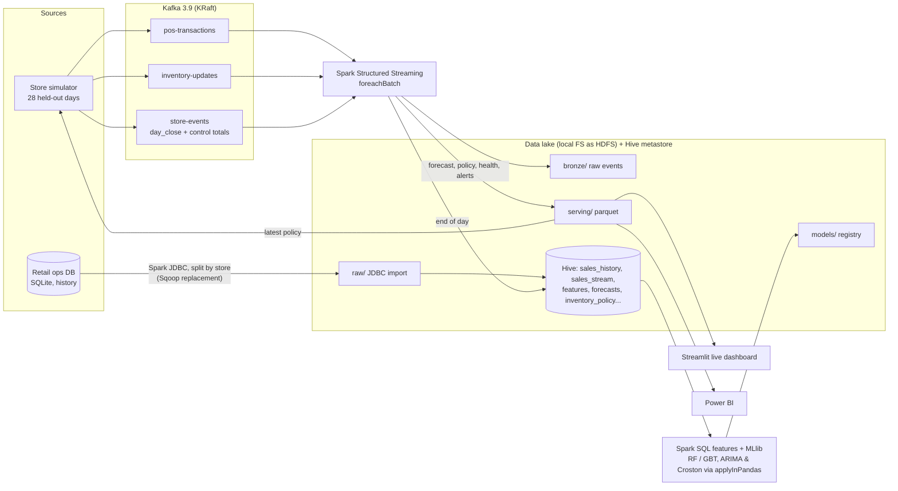

# Real-time retail demand forecasting (Kafka · Spark Streaming · Hive · MLlib)

This project forecasts demand at SKU-store level and keeps the forecast current as sales stream in. It runs on Walmart's **M5** data (3,049 products, 10 stores, 1,941 days). The modelled, streamed and optimised scope is the four California stores, which hold 12,196 SKU-store series.

History up to 2016-05-22 sits in an "operational" retail database and is batch-imported into a data lake. The **28 held-out days after that are never loaded in batch**. A store simulator replays them through Kafka as point-of-sale transactions, inventory movements and end-of-day closes. A Spark Structured Streaming job turns that stream into:

* sales landed in the lake (bronze) and daily sales in Hive (silver),
* a live view of units sold today against the forecast, with real-time stock-out alerts,
* when a day closes: forecast accuracy, inventory health, a refreshed 7-day forecast and a new replenishment policy (safety stock, reorder point, EOQ), which the simulated stores order against the next day,
* every 7 days, a challenger model retrained in the background and promoted only if it beats the champion on the latest week.

A Streamlit dashboard reads the serving layer and refreshes every 5 seconds. Power BI can read the same files ([docs/power_bi.md](docs/power_bi.md)).

## Architecture



| Brief | What runs here | Why |
|---|---|---|
| Kafka ingests POS, e-commerce and inventory streams | Apache Kafka 3.9.1, single broker in KRaft mode, three topics | real broker, no mock |
| Sqoop loads historical batch data into HDFS | Spark JDBC import with one split per store, plus a row-count and unit-sum reconciliation (Sqoop's `--validate`) | Sqoop was retired to the Apache Attic in 2021, and Spark JDBC is what replaced it |
| HDFS data lake | local filesystem through Hadoop's `file://` FileSystem API, laid out as raw / bronze / warehouse / serving | no Docker or WSL on this machine (Windows 11 Home, 7.8 GB RAM); the code is unchanged apart from the path scheme |
| Hive tables | Spark's built-in Hive metastore (embedded Derby) and Hive-managed Parquet tables | real Hive catalog. Embedded Derby allows one Spark process at a time, so dashboards read the serving files instead |
| Spark SQL features | window functions: lags, rolling means and spread, zero share, department-store level, price and markdown, SNAP, events | [rdf/features.py](rdf/features.py) |
| ARIMA, RF, GBT in Spark MLlib | MLlib `RandomForestRegressor` and `GBTRegressor` (global models); ARIMA (statsmodels) and Croston/SBA per series, distributed with `groupBy().applyInPandas` | MLlib has no ARIMA, so per-series models run as distributed pandas UDFs |
| EOQ, newsvendor, reorder points | newsvendor critical ratio → service level; negative-binomial lead-time demand → reorder point and safety stock; EOQ order quantity | [rdf/inventory.py](rdf/inventory.py) |
| Live dashboard and alerts | Streamlit dashboard plus an alert feed (real-time stock-outs, close-of-day stock-outs, demand anomalies), CSV export and optional webhook | [app.py](app.py) |

## Design decisions worth knowing

**No look-ahead anywhere.** Every lag feature for day *t* uses sales up to *t*−7. Each row is also assigned a forecast origin *o* on a weekly grid, with horizon *h* = *t*−*o* in 1..7 and "as of origin" features: the last value, 7- and 28-day means ending at *o*, and days since the last sale. One model therefore forecasts 1 to 7 days ahead and still uses yesterday's sales for tomorrow, without copying each training row seven times. A Spark test perturbs future sales and checks that no feature moves ([tests/test_features_spark.py](tests/test_features_spark.py)).

**The day closes only when the data reconciles.** Kafka keeps order within a partition, not across topics, so a `day_close` event can arrive before the last sales of that day. Each close message carries control totals (POS lines and units per store), and the processor acts on a day only once the bronze data matches them. Days close strictly in order.

**Reorder points for intermittent demand.** Most M5 SKU-days are zero. A normal approximation of lead-time demand gives negative or inflated reorder points for slow movers, so lead-time demand is negative binomial: its mean is the forecast and its variance comes from the model's own backtest error. The service level is the newsvendor critical ratio, using margin as the underage cost and holding plus spoilage/markdown as the overage cost, clipped to 80-99%.

**Censored sales.** Recorded sales are capped by stock. The simulator records lost units when a shelf runs empty, and retraining excludes stock-out days so the model doesn't learn that empty shelves mean no demand.

**Retraining never blocks the stream.** The challenger trains in a background thread on the same SparkSession (FAIR scheduler pool) on data up to day−7. It is compared with the champion on the last 7 streamed days, which both models have never seen, and promoted only if its WAPE is lower. The registry is a JSON file, and the stream reloads the champion when it changes.

**Serving files are swapped atomically** (write to temp, then `os.replace`, retried while Windows holds a reader's lock), so the dashboard never reads a half-written file.

## Results

See [docs/results.md](docs/results.md) for the full tables.

<!-- RESULTS -->

## Limitations (stated, not hidden)

* **Synthetic parts.** M5 has no stock levels, costs, transactions or e-commerce channel. Opening stock, the cost assumptions ([rdf/config.py](rdf/config.py)), the split of daily units into POS lines and the 15% online share are simulated. The demand itself is real.
* **Single machine.** The cluster pieces (HDFS, a multi-broker Kafka, a Hive metastore service, Spark on YARN or Kubernetes) are replaced by single-node equivalents. The code would move to a cluster by changing paths and the Spark master, not the logic.
* **MLlib vs LightGBM.** MLlib's tree models have no Poisson or Tweedie loss and no native categorical splits, which is a real handicap on zero-heavy retail data. The M5 winners used LightGBM. MLlib is used here because the brief asks for distributed training.
* **At-least-once landing.** `foreachBatch` can replay a micro-batch after a crash. Bronze can then hold duplicates, but every downstream step de-duplicates on `txn_id`, so silver and gold are exactly-once in effect.
* **Data source.** The official M5 files need Kaggle competition rules accepted. This run used the public MIT-licensed parquet mirror `marcozanotti/m5-competition-dataset-parquet` (same data, long format, leading zeros before each product's launch trimmed).

## Run it

Requirements: Python 3.13, a portable JDK 17, `winutils.exe` and `hadoop.dll` (Hadoop 3.3.6 build) in `%HADOOP_HOME%\bin`, and Kafka 3.9.1. The paths are in [rdf/config.py](rdf/config.py).

```bash
python -m venv .venv && .venv/Scripts/pip install -e . pyspark==4.0.4 confluent-kafka pandas pyarrow statsmodels scipy streamlit plotly matplotlib tabulate pytest
kaggle datasets download marcozanotti/m5-competition-dataset-parquet -p data/raw/m5 --unzip

python scripts/build_retail_db.py        # operational DB (history only)      ~7 min
python scripts/ingest_batch.py           # Spark JDBC -> lake -> Hive          ~4 min
python scripts/train.py                  # features, backtest, champion, plan  ~25 min

powershell -File scripts/kafka.ps1 -Format              # terminal 1: broker
python scripts/stream_processor.py --reset              # terminal 2: Spark streaming
python scripts/store_simulator.py --seconds-per-day 90 --wait-for-plan   # terminal 3
streamlit run app.py                                    # terminal 4: dashboard

python scripts/report.py                 # after the replay: docs/results.md + figure
python -m pytest                         # unit tests + Spark leakage test
```
