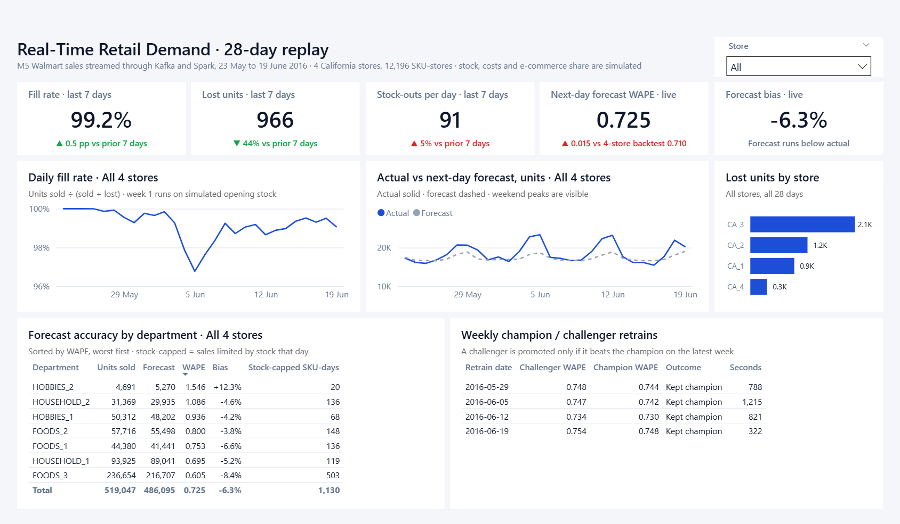
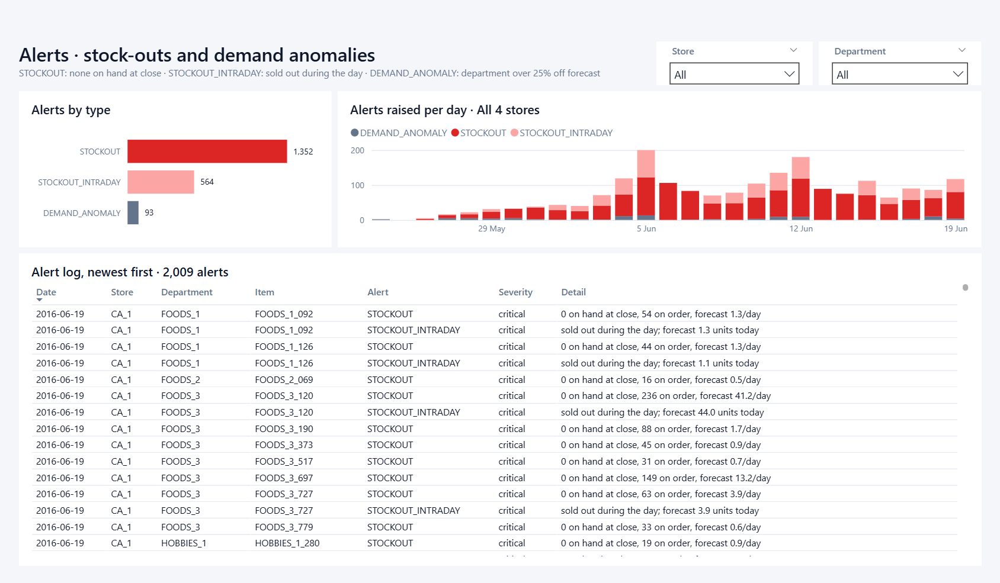

# Power BI report and web dashboard

The replay results come in two forms built on the same numbers:

* **Power BI report**: [powerbi/RetailDemand.pbip](../powerbi/RetailDemand.pbip), a Power BI project (TMDL semantic model + PBIR report) kept in git as text.
* **Web dashboard**: [docs/dashboard/](dashboard/), served by GitHub Pages at <https://downey112.github.io/retail-demand-rt/dashboard/>. It is a static page with the same layout and figures, for anyone without Power BI Desktop.

Both use a small extract written by `scripts/export_bi.py`, not the full serving layer. Power BI reads `powerbi/data/*.csv` and the web page reads the same tables from `docs/dashboard/data.json`. Rerun the script after a replay so that both update. It also prints the fill rate and WAPE so you can check them against [results.md](results.md).

```bash
python scripts/export_bi.py   # after the replay: powerbi/data/*.csv + docs/dashboard/data.json
```

## Opening the Power BI report

1. Open `powerbi/RetailDemand.pbip` in Power BI Desktop (PBIR enabled, which is the default in current releases).
2. If the repo is not at `C:\Users\courts\retail-demand-rt`, change the `DataFolder` parameter (**Transform data → Edit parameters**) to your `powerbi\data` folder.
3. Select **Refresh**. A fresh clone holds no cached data, so visuals show *(Blank)* until the first refresh.

## Report design

Two 1280 × 720 pages laid out on an 8 px grid. The canvas is `#F4F6F9` and visuals sit on white cards. In the KPI cards, red and green are used only for variances, always with a ▲/▼ symbol. Alert types use fixed colours (red shades for stock-outs in Power BI, validated categorical hues on the web).

**Replay overview** is read top to bottom:

| Tier | Visuals |
|---|---|
| Summary | Five KPI cards. Fill rate, lost units and stock-outs at close cover the last 7 days against the 7 days before. Live WAPE is compared with the backtest WAPE (0.710). Forecast bias is shown with a plain-language label. |
| Drivers | Daily fill-rate line, actual vs next-day forecast lines (forecast dashed), and lost units by store as sorted bars. |
| Detail | Forecast accuracy by department (WAPE, bias, stock-out SKU-days), and the weekly champion/challenger retrain log. |



**Alerts** has alert counts by type, alerts per day stacked by type, and the full alert log (filterable by store and department).



### Semantic model

| Table | Grain | Source |
|---|---|---|
| `fact_inventory` | day × store | `inventory_daily`: units sold, lost units, SKU status counts, inventory value |
| `fact_forecast` | day × store × department | `sku_actual_vs_forecast` summed: units, forecast, **absolute error summed at SKU level** (so WAPE stays a true SKU WAPE after aggregation), and stock-capped SKU-days (sales limited by stock that day; this is not the same as the end-of-day stock-out count in `fact_inventory`) |
| `alerts` | one row per alert | `alerts` |
| `model_events`, `backtest` | retrain / model | retraining history and backtest metrics |
| `dim_date`, `dim_store`, `dim_dept` | dimensions | built in Power Query |

Measures are grouped into display folders: Base, Comparison, Variance, Labels, Colors and Titles. The comparison measures use a 7-day window that ends on the latest day with data. Date filters are ignored, so clicking a point on a trend chart cannot shrink the window:

```DAX
Fill Rate L7D =
VAR _end = CALCULATE ( MAX ( fact_inventory[business_date] ), REMOVEFILTERS ( dim_date ) ) - 0
RETURN
    CALCULATE (
        [Fill Rate],
        REMOVEFILTERS ( dim_date ),
        dim_date[date] > _end - 7,
        dim_date[date] <= _end
    )
```

Lost units and stock-outs are "lower is better" metrics, so their colour measures are inverted: a rise shows red. Live WAPE is compared with the pooled 4-store backtest, so with one store selected that comparison is only indicative. The lost-units-by-store chart ignores the store slicer so that stores can always be compared.

## Publishing the Power BI report to the web

Power BI **Publish to web** needs a work or school Microsoft account with a Power BI licence, and the tenant admin must allow embed codes. A personal Gmail or Outlook account cannot sign in to the Power BI service. With such an account:

1. The replay data is fixed, so the simplest route is to publish the model already refreshed in Desktop and skip scheduled refresh. For refresh in the service, move the CSVs to SharePoint/OneDrive, or read the raw GitHub URLs with `Web.Contents("https://raw.githubusercontent.com", [RelativePath = "Downey112/retail-demand-rt/master/powerbi/data/fact_inventory.csv"])`. Keep the base URL static and use forward slashes; the current `DataFolder & "\..."` form only suits local paths.
2. **Home → Publish** to a workspace.
3. In the service: **File → Embed report → Publish to web (public)**, then copy the link or iframe code into this README.

Publish to web makes the report public to anyone with the link. That is fine here because all of the data is the public M5 dataset plus simulated values.

## Raw serving layer (for live reports)

The stream processor keeps the full serving layer in `lake/serving/` as Parquet files. Each file is replaced atomically, so a reader never sees a half-written file. The Streamlit app reads these directly, and Power BI can too (**Get data → Parquet**):

| File | Grain | Use |
|---|---|---|
| `demand_vs_forecast.parquet` | day × store × department | actual units vs next-day forecast |
| `accuracy_daily.parquet` | day × store × horizon (1-7) | WAPE by lead time |
| `sku_actual_vs_forecast.parquet` | day × SKU × store | drill-through |
| `inventory_daily.parquet` | day × store | stock-outs, below-ROP and overstock counts, fill rate, inventory value |
| `inventory_health.parquet` | SKU × store (latest close) | on hand, reorder point, days of cover, status |
| `inventory_policy.parquet` | SKU × store (latest) | service level, safety stock, reorder point, EOQ |
| `alerts.parquet` | one row per alert | alert feed |
| `intraday_sku.parquet`, `intraday_hourly.parquet` | current business day | live view |
| `model_metrics.parquet`, `model_events.parquet` | model | backtest and retraining history |

In a production lakehouse these would be Hive/Delta tables behind a Spark Thrift or Databricks SQL endpoint, and Power BI would connect in DirectQuery with automatic page refresh. Here the embedded Derby metastore allows only one Spark process at a time, so the Parquet files stand in for that endpoint.
