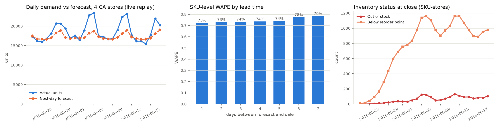

# Replay results

Replay of 28 held-out days (2016-05-23 to 2016-06-19), stores CA_1, CA_2, CA_3, CA_4.

## Backtest (last 4 weeks of history)

| model          |   wape |   rmse |   rmsse |   bias |      n | subset           |
|:---------------|-------:|-------:|--------:|-------:|-------:|:-----------------|
| rf             |  0.71  |  2.126 |   0.782 | -0.025 | 341488 | all_series       |
| gbt            |  0.713 |  2.159 |   0.786 | -0.023 | 341488 | all_series       |
| ma28           |  0.723 |  2.136 |   0.795 | -0.029 | 341488 | all_series       |
| sba_croston    |  0.737 |  2.174 |   0.805 | -0.048 | 341488 | all_series       |
| seasonal_naive |  0.868 |  2.652 |   1.058 | -0.012 | 341488 | all_series       |
| arima          |  0.651 |  1.938 |   0.749 | -0.03  |   8400 | arima_sample_300 |
| sba_croston    |  0.666 |  2.03  |   0.758 | -0.04  |   8400 | arima_sample_300 |
| ma28           |  0.671 |  2.113 |   0.758 | -0.009 |   8400 | arima_sample_300 |
| rf             |  0.672 |  2.271 |   0.75  | -0.003 |   8400 | arima_sample_300 |
| gbt            |  0.673 |  2.26  |   0.754 |  0.004 |   8400 | arima_sample_300 |
| seasonal_naive |  0.795 |  2.551 |   1.003 | -0.011 |   8400 | arima_sample_300 |

## Live replay

* Next-day forecast, SKU level: WAPE **0.725**, bias **-6.3%** over 341,488 SKU-store-days.
* Units sold 519,047, lost to stock-outs 4,521: fill rate **99.14%**.
* Fill rate by replay week: week 1 99.9%, week 2 98.8%, week 3 98.7%, week 4 99.2%; weekdays 99.3%, weekends 98.8%. Week 1 runs on the simulated opening stock; later weeks show the policy on its own.
* SKU-stores out of stock at close: mean 60 per day (of 12,196).
* Alerts raised: STOCKOUT 1,352, STOCKOUT_INTRADAY 564, DEMAND_ANOMALY 93.
* Micro-batches: 149; median batch time 8.9s; 95th percentile event age when processed 79s.

## Retraining events

| business_date   | challenger         | champion           |   challenger_wape |   champion_wape | promoted   |   seconds |
|:----------------|:-------------------|:-------------------|------------------:|----------------:|:-----------|----------:|
| 2016-05-29      | rf-20261016T055212 | rf-20261015T152231 |             0.748 |           0.744 | False      |   788.033 |
| 2016-06-05      | rf-20261016T063301 | rf-20261015T152231 |             0.747 |           0.742 | False      |  1215.06  |
| 2016-06-12      | rf-20261016T070424 | rf-20261015T152231 |             0.734 |           0.73  | False      |   821.072 |
| 2016-06-19      | rf-20261016T095918 | rf-20261015T152231 |             0.754 |           0.748 | False      |   322.476 |

